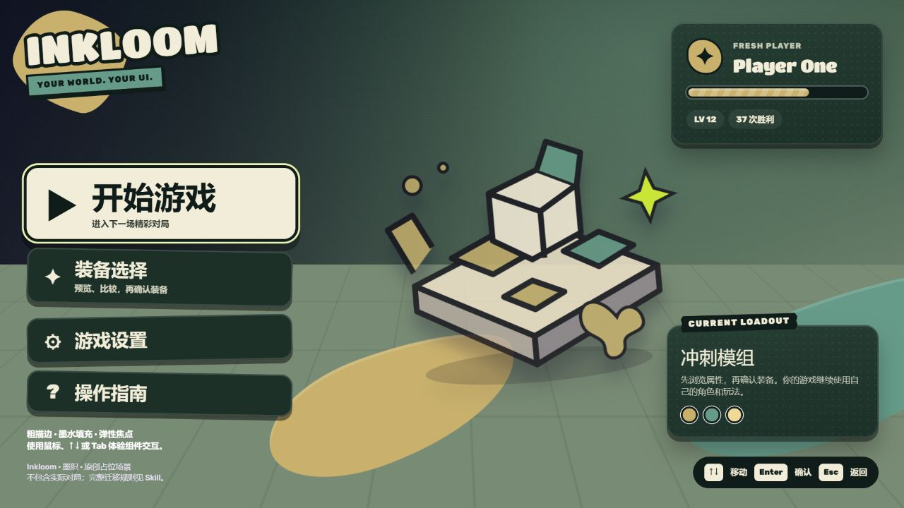
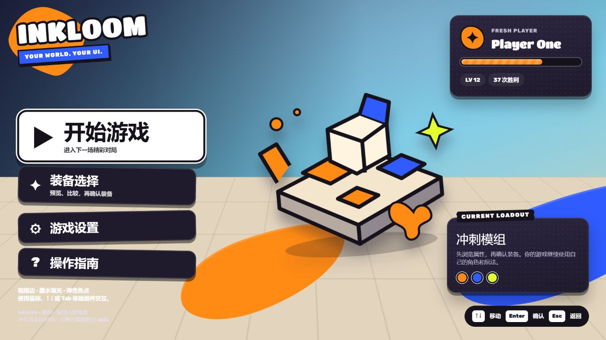
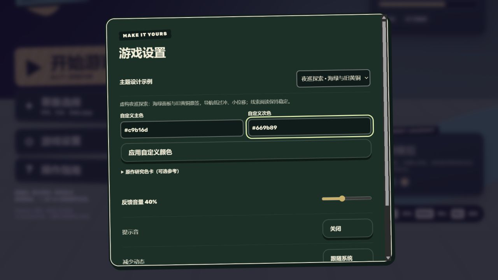
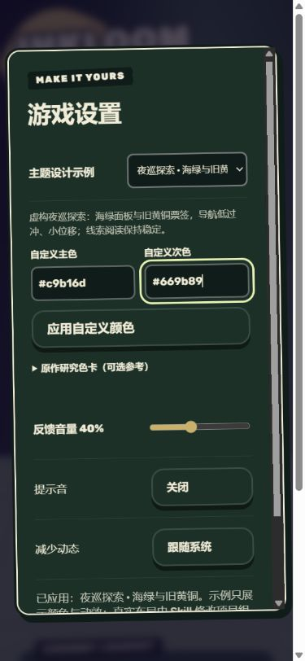
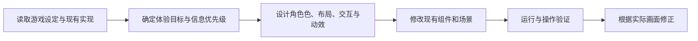

<div align="center">

# Inkloom · 墨织

### 把游戏设定，织成有触感的界面。

受 INKWAVE 启发的自适应游戏 UI Skill：先理解题材、世界观和玩法，再设计配色、布局、交互与动效。

**Codex Skill · Web 参考组件 · Godot / Unity 适配指南 · MIT / OFL**

[开始使用](#安装与调用) · [UI 效果图](#ui-效果图) · [设计规则](skills/inkwave-game-ui/references/adaptive-design.md) · [English](README.en.md)

</div>



> 上图是仓库自带 Web 组件的真实浏览器截图，使用原创占位场景。它展示主题和反馈的应用方式，不代表一款完整游戏已完成开发。

## 它能做什么

给正在开发的游戏调用一次 Skill，Codex 会读取项目设定、美术、玩法代码、现有 UI 和操作方式，形成设计判断，并在原有技术栈里实施改造。

| 设计维度 | 具体工作 |
|---|---|
| 游戏理解 | 识别题材、世界观、体验目标、核心循环、信息优先级和输入设备 |
| 自适应配色 | 为面板、文字、主次强调、行动、焦点、危险等分配语义颜色，支持原作色卡之外的新主题 |
| 布局 | 围绕玩家任务与视角安排菜单、详情、HUD、对白和主操作，适配窄屏与安全区 |
| 交互 | 处理预览、确认、装备、返回、暂停、焦点恢复和输入归属 |
| 动效 | 分别调节导航、即时告警、切屏和奖励的时长、位移、弹性与频率 |
| 实施与验证 | 修改现有组件/场景，绑定真实数据，检查核心流程、可读性与输入行为 |

它保留 INKWAVE 的厚实字形、粗墨轮廓、贴纸切边、硬投影、有机墨形和触感反馈。**五组原作配色仅作研究参考**；深紫底、荧光黄绿、固定左右布局和强弹跳都可以按游戏重新设计。

## UI 效果图

以下图片均来自本仓库 Web 样例；相同组件在不同主题中调整颜色和反馈参数。真实项目中的布局与业务流程由 Codex 依据游戏需求修改。

| 活泼菜单 · 原作语言参考 | 夜巡探索 · 海绿与旧黄铜 |
|---|---|
|  |  |
| 鲜明强调色、胖字、墨边与按压反馈 | 有色深面板、暖纸切边、低过冲与较小位移 |

<details>
<summary><strong>展开查看主题设置与手机效果</strong></summary>



主题示例、任意 `#rrggbb` 主次色、独立的面板/行动/危险语义、减少动态。截图中的示例不限制 Skill 可以生成的主题。



390px 视口下设置可滚动，控件保持可达；这是浏览器响应式验证，不是硬件触屏或手柄测试。

</details>

[截图说明与验证边界](docs/gallery.md)

## 安装与调用

### 在 Codex 中安装

把下面这段话发给 Codex：

```text
请安装 https://github.com/LTY4869822/inkloom-game-ui-skill 中
skills/inkwave-game-ui 目录下的 Skill。
```

也可以在提供官方 `skill-installer` 的环境使用：

```powershell
python "$env:USERPROFILE\.codex\skills\.system\skill-installer\scripts\install-skill-from-github.py" --repo LTY4869822/inkloom-game-ui-skill --path skills/inkwave-game-ui
```

macOS / Linux：

```bash
python3 ~/.codex/skills/.system/skill-installer/scripts/install-skill-from-github.py \
  --repo LTY4869822/inkloom-game-ui-skill --path skills/inkwave-game-ui
```

已有同名 Skill 时，使用更新流程并保留自己的修改。安装后在下一条消息中调用。

### 在游戏项目中调用

**展示名是 Inkloom · 墨织，技术调用名保留为 `$inkwave-game-ui`。**

```text
$inkwave-game-ui
先分析当前游戏的题材、设定和玩法，
再自主设计并实现颜色、布局、交互和动效。
保留 INKWAVE 的设计语言及现有玩法，配色不限原作预设。
```

也可以补充项目约束：

```text
$inkwave-game-ui
这是一个竖屏经营游戏。保留现有资源颜色，优先照顾单手操作，
减少高频领取奖励时的动画。请完成现有菜单、生产面板和 HUD 的改造。
```

有完整设定就提供设定；只有代码时，Skill 会从已有项目提取证据并标明必要假设。它不会因套用风格而新增不存在的阵营、武器、货币或联机系统。

## 工作方式



设计判断由调用 Skill 的 Codex 完成。附带的 `applyInkTheme` 函数负责应用已决定的颜色和动效参数；它本身不会读取故事、理解玩法或自动生成布局。

## 本地体验 Web 样例

```bash
git clone https://github.com/LTY4869822/inkloom-game-ui-skill.git
cd inkloom-game-ui-skill
python skills/inkwave-game-ui/scripts/serve-preview.py
```

打开终端输出的 `http://127.0.0.1:8493/web/preview.html`。macOS / Linux 可将 `python` 换成 `python3`。端口占用时加 `--port 8494`。

服务器只使用 Python 标准库并绑定本机回环地址。静态样例无需构建或 API key；请通过 HTTP 打开，以便浏览器加载 ES 模块。

可以体验：

- 鼠标墨水焦点、方向键与 Tab 导航、按压反馈。
- 装备预览与提交分离，关闭弹窗恢复焦点。
- 夜巡 / 经营主题示范、任意主次色输入及错误值保护。
- 音量、可选提示音与减少动态。
- 桌面与窄屏布局。

## 项目结构

```text
inkloom-game-ui-skill/
├── README.md / README.en.md
├── LICENSE / THIRD_PARTY_NOTICES.md
├── docs/
│   ├── gallery.md
│   └── images/                       实际样例截图
├── skills/inkwave-game-ui/
│   ├── SKILL.md                      Skill 入口
│   ├── agents/openai.yaml            展示名和默认调用语句
│   ├── references/
│   │   ├── adaptive-design.md        从游戏证据到设计判断
│   │   ├── source-analysis.zh-CN.md  INKWAVE 源码研究
│   │   ├── interaction-spec.md       状态和交互契约
│   │   ├── engine-adapters.md        Web / Godot / Unity 适配
│   │   ├── acceptance.md             实施验收
│   │   └── screenshots/             标注过的原作研究截图
│   ├── assets/                       参数、主题示例、字体与 Web 组件
│   └── scripts/serve-preview.py
└── tests/theme-api.test.mjs
```

## 验证与适用范围

已运行 Skill 格式检查、JSON 与内部链接检查、JS 语法和主题 API 测试，并实际操作 Web 样例验证主题切换、自定义颜色、非法值保护、减少动态及 390px 设置界面。

```bash
node tests/theme-api.test.mjs
```

| 部分 | 当前状态 |
|---|---|
| Skill 与设计规范 | 已提供，适用于现有项目的分析和实施 |
| Web 参考组件 | 已运行与浏览器操作验证 |
| Godot / Unity | 提供引擎适配指南，本仓库未运行对应编辑器验证 |
| 游戏系统 | 样例不包含真实对局、完整结算、地图系统或手柄轮询，需要接入目标项目已有实现 |

效果图中的场景为原创占位图形。`references/screenshots/` 保存的是原作/原 UI Lab 研究材料，和上方 Inkloom 样例效果图分开标注。

## 常见问题

**每个游戏都会变成同一种颜色和位置吗？**

会先分析实际任务、视角和设备。无队伍的游戏无需双色阵营；棋盘游戏保护棋盘，剧情游戏保护对白；主操作可以侧置、居中或放在底部。

**可以只改某一部分吗？**

可以。调用时注明“只改设置”“只调整 HUD”“保留品牌色”等，Skill 按授权范围实施。

**为什么保留 `inkwave-game-ui` 这个调用名？**

它保留现有安装与历史调用的兼容性。Inkloom 是项目展示名，INKWAVE 是设计研究来源。

**中文字体是否包含在内？**

附带的 Titan One / Rubik 是 Latin 子集。中文使用目标项目合法的粗黑/圆黑字体，或系统字体回退；字形与描边需要按实际画面调整。

## 贡献与许可

欢迎提供带游戏背景和实际截图的改进案例，见 [CONTRIBUTING.md](CONTRIBUTING.md)。

项目采用 [MIT](LICENSE)，派生代码保留 INKWAVE 原作者 Jayden Davis 的版权说明；附带字体采用 SIL OFL 1.1。来源和独立性说明见 [THIRD_PARTY_NOTICES.md](THIRD_PARTY_NOTICES.md)。

Inkloom 是独立的设计技能项目，受 [amiaoapp/inkwave](https://github.com/amiaoapp/inkwave) 启发，不是其官方版本，也不隶属于 Nintendo。
